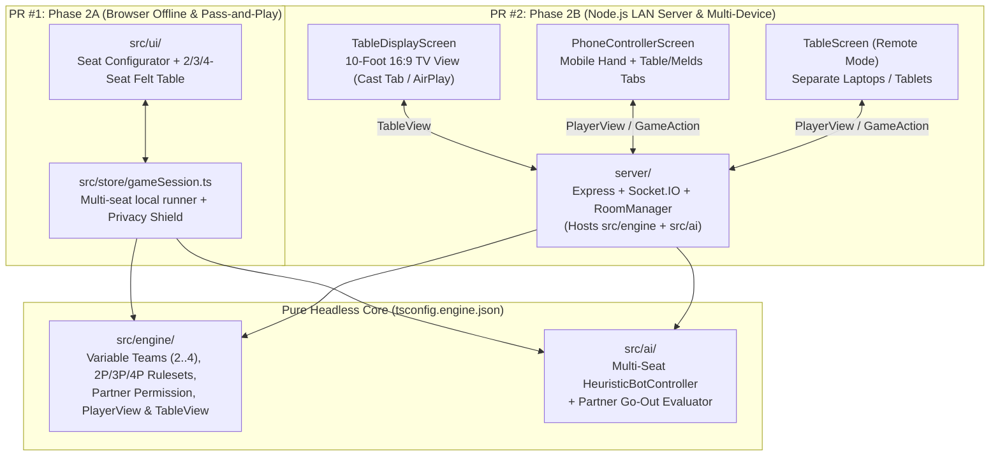
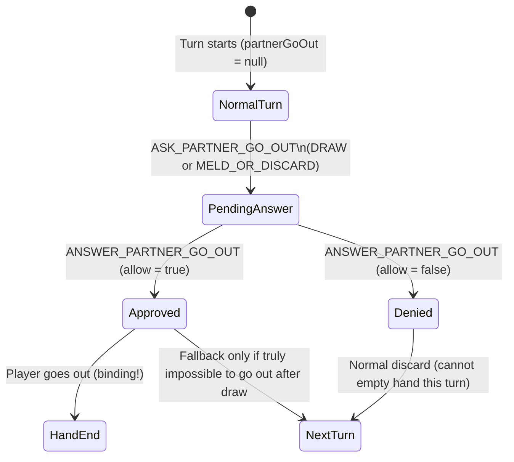

# Web-Based Canasta — Phase 2 Software Design Document (`sdd-phase2.md` v1.1)

> [!IMPORTANT]
> Derived from locked **PRD v2.0** and updated with all technical alignment decisions. Once approved, we will sync `docs/sdd-phase2.md` and begin implementing **Phase 2A** on branch `feat/phase-2a-multiseat` (PR #1), followed by **Phase 2B** on `feat/phase-2b-lan-multiplayer` (PR #2).

---

## 1. Architectural Overview & Two-PR Strategy

Phase 2 preserves the Phase 1 invariant: **`src/engine/` and `src/ai/` remain 100% pure ES2022 TypeScript** (enforced by `tsconfig.engine.json`) with zero React, DOM, or networking imports.



---

## 2. Phase 2A Technical Design: Multi-Seat Engine, Partner Permission & Offline UI

### 2.1 Variable-Team Generalization (`src/engine/types.ts`)
Replace the Phase 1 fixed 2-team tuple with variable-length team arrays (supporting 2, 3, or 4 teams cleanly):

```ts
export type TeamId = 'team-0' | 'team-1' | 'team-2' | 'team-3';

export interface RulesetConfig {
  // Existing fields preserved, plus:
  playerCount: 2 | 3 | 4;
  teamCount: 2 | 3 | 4;
  allowPartnerGoOutPrompt: boolean; // true for BICYCLE_4P_PARTNERSHIP only
}

export interface PartnerGoOutState {
  askedByPlayerId: string;
  partnerPlayerId: string;
  status: 'PENDING' | 'APPROVED' | 'DENIED';
}

export interface GameState {
  schemaVersion: 2; // Clean reset: older v1 localStorage payloads are safely ignored on load
  // ...
  teams: TeamState[];                 // Length 2, 3, or 4 (was [TeamState, TeamState])
  partnerGoOut: PartnerGoOutState | null;
  // ...
}

export interface HandSummary {
  handNumber: number;
  reason: HandEndReason;
  wentOutPlayerId: string | null;
  wentOutTeamId: TeamId | null;
  breakdowns: HandScoreBreakdown[];   // Matches teams.length
}
```

### 2.2 Official Phase 2A Ruleset Presets (`src/engine/rulesets.ts`)

| Constant | `playerCount` | `teamCount` | `dealSize` | `drawCount` | `canastasRequiredToGoOut` | `allowPartnerGoOutPrompt` |
| :--- | :---: | :---: | :---: | :---: | :---: | :---: |
| `BICYCLE_2P_CLASSIC` | 2 | 2 | 15 | 2 | 2 | `false` |
| `BICYCLE_3P_CUTTHROAT` | 3 | 3 | 13 | 1 | 1 | `false` |
| `BICYCLE_4P_PARTNERSHIP` | 4 | 2 | 11 | 1 | 1 | `true` |
| `BICYCLE_4P_CUTTHROAT` | 4 | 4 | 11 | 1 | 1 | `false` |

- **4P Partnership Seating Convention:** `Seat 0 (South)` & `Seat 2 (North)` → `'team-0'`; `Seat 1 (West)` & `Seat 3 (East)` → `'team-1'`. Clockwise turn progression `0 → 1 → 2 → 3 → 0` naturally alternates teams every turn.
- **Cutthroat Seating Convention:** Seat `i` belongs to `team-${i}` (`3` or `4` teams).

### 2.3 Binding Partner Permission State Machine (`"Partner, may I go out?"`)



#### New Engine Actions
```ts
| { type: 'ASK_PARTNER_GO_OUT'; playerId: string }
| { type: 'ANSWER_PARTNER_GO_OUT'; playerId: string; allow: boolean }
```

#### Strict Rules & Edge-Case Guardrails
1. **When Asking Is Legal (`canAskPartnerGoOut`):**
   - `ruleset.allowPartnerGoOutPrompt === true` and `team.playerIds.length === 2`.
   - `phase === 'DRAW' || phase === 'MELD_OR_DISCARD'`.
   - `state.partnerGoOut === null` (may only ask once per turn).
   - Active player has not yet ended their turn.
2. **While `partnerGoOut.status === 'PENDING'`:**
   - All normal turn actions (`DRAW_STOCK`, `TAKE_DISCARD_PILE`, `COMMIT_MELDS`, `DISCARD`, `UNDO_TURN_MELDS`, `PASS_EXHAUSTED_STOCK`) are blocked until the partner submits `ANSWER_PARTNER_GO_OUT`.
   - `PlayerView.legalHints` exposes `mustAnswerPartnerGoOut: boolean` (true **only** for `partnerPlayerId`) and `partnerGoOut` public status.
3. **Binding `DENIED` Enforcement:**
   - During `MELD_OR_DISCARD`, `COMMIT_MELDS` and `TAKE_DISCARD_PILE` reject any play leaving `remainingHand <= 1` (so player cannot empty their hand or trap themselves into discarding their last card), and `DISCARD` rejects discarding the final card.
   - Resets to `partnerGoOut = null` when the turn advances.
4. **Binding `APPROVED` Enforcement (with Zero-Deadlock Safety):**
   - Player **must** go out on this turn if they have a legal way to do so.
   - Helper `canPlayerGoOutNow(state, playerId)` checks whether the player can legally empty their hand right now (either `hand.length === 1` with `canastas >= required` via `DISCARD`, OR by melding all remaining cards/all-but-1 via existing melds / new melds / Black 3s).
   - If `partnerGoOut.status === 'APPROVED'` and the player attempts to `DISCARD` while keeping cards (`remainingHand > 0`) **and** `canPlayerGoOutNow(state, playerId)` is true → engine rejects with `"Your partner approved going out — you are bound to go out this turn."`
   - **Pre-draw safety fallback:** If the player asked *before* drawing, partner said Yes, and after drawing they genuinely have **no** legal go-out combination (`!canPlayerGoOutNow`), `DISCARD` is allowed with a Table Log note (*"Unable to go out after drawing despite partner approval — play continues."*) so the game can **never** soft-lock!
5. **Turn Undo Compatibility:** `UNDO_TURN_MELDS` never reverts `partnerGoOut` (once asked and answered, the partner's binding answer stands for the turn!).

### 2.4 Multi-Seat & Partnership AI Upgrades (`src/ai/`)
- **Multi-Opponent Awareness (`heuristicBot.ts`):**
  - Replace single `oppTeam` lookup with `oppTeams = view.teams.filter(t => t.id !== view.viewerTeamId)`.
  - **Clockwise Threat Weighting:** Discards that match the **next player's team melds** (left-hand opponent) carry the highest penalty (`+140` when unfrozen), since they get first claim; other opponent teams carry `+90`.
  - **4P Partnership Coordination:** When discarding, slightly prefer safe cards that don't break own structure while avoiding feeding the next opponent; on `Hard`, avoid breaking partner's potential Natural Canasta when adding a wild card to a shared meld.
- **Bot Partner Permission (`chooseAction`):**
  - When `view.legalHints.mustAnswerPartnerGoOut === true`: bot invokes `evaluatePartnerGoOutRequest(view)`:
    - Computes its own unmelded hand penalty (`handPts`), wild count, and opponent minimum hand count.
    - Answers **`allow: true`** if: `handPts <= 70`, OR team's projected score reaches `winScore`, OR `view.stockCount <= 12`, OR any opponent has `<= 4` cards.
    - Answers **`allow: false`** if: `handPts > 70` AND bot holds at least 1 playable meld / Canasta completion on its next turn AND opponents aren't threatening (`oppMinCards >= 6`).
  - When a **Bot** is active in 4P Partnership, has a **Human partner**, can legally go out right now, and `!view.partnerGoOut`: bot emits `ASK_PARTNER_GO_OUT` first so the human partner gets to make the strategic call!

### 2.5 Phase 2A UI & Pass-and-Play Updates (`src/ui/`, `src/store/`)
- **Start Screen (`StartScreen.tsx`):**
  - Format selector: **2P Classic**, **3P Cutthroat**, **4P Partnership**, **4P Cutthroat**.
  - Quick lineup buttons (e.g., `Solo vs. Bots`, `2 Humans (Partners) + 2 Bots`, `All Humans`) + per-seat **Human / Bot (`Easy` | `Normal` | `Hard`)** toggle and editable player name.
- **Multi-Seat Table Layout (`TableScreen.tsx`):**
  - **2P Classic:** Unchanged Phase 1 layout.
  - **4P Partnership:** Compact top bar with 3 opponent/partner seat badges (`West`, `North ★ Partner`, `East` showing card-back count & active-turn glow) + 2 generous MeldZones (`Your Team's Melds` and `Opponents' Melds`).
  - **3P & 4P Cutthroat:** Responsive 2- or 3-column compact opponent strip across the top (`West`, `North`, `East`). Each opponent card displays player name, active-turn badge, hand count, Red 3 count/bonus pill, and **crisp clickable meld pills** (e.g., `Ks (4) • 1W`, `👑 8s Natural +500`) that open the existing full-card Inspect Popover on click—keeping `Your Melds`, Stock/Discard, Action Bar, and Hand cleanly inside `1280×800` with zero vertical scroll.
- **Partner Permission UI (`PartnerPromptModal.tsx`):**
  - Action Bar shows an optional **`Ask Partner to Go Out`** button in 4P Partnership when `legalHints.canAskPartnerGoOut`.
  - When `mustAnswerPartnerGoOut` is true, renders a clean modal: *"[Partner Name] asks: May I go out?"* with **`Yes — Go Out (Binding)`** and **`No — Keep Playing`** buttons.
  - In Pass-and-Play with 2 human partners, briefly opens the Privacy Shield curtain addressed to the Partner (`Pass to [Partner] to answer go-out request`) so they can inspect their own hand before answering, then hands back to the active player!
- **Dynamic Multi-Column Scoreboard & Hand Summary:**
  - `RulesScoringDrawer.tsx` and `HandSummaryModal.tsx` loop over `teams` dynamically (2, 3, or 4 columns), and the Rules tab automatically adds the **4-Player Partner Permission** section when `ruleset.allowPartnerGoOutPrompt` is true.

---

## 3. Phase 2B Technical Design: Node.js WebSocket Server & Multi-Device LAN

### 3.1 Server Stack & Directory Layout (`server/`)

New dependencies added in Phase 2B: `express`, `socket.io`, `socket.io-client`, `qrcode`, `tsx` (dev), `concurrently` (dev).

```text
canasta/
├── server/
│   ├── index.ts          # Express + Socket.IO HTTP server (:3001), /api/network-info, static dist/ in prod
│   ├── roomManager.ts    # Room lifecycle, 4-char codes, seat claiming, seatToken reconnects, bot takeover
│   ├── botRunner.ts      # Server-side paced HeuristicBotController turn execution per room
│   └── networkInfo.ts    # Auto-detects host LAN IPv4 address via os.networkInterfaces()
├── src/
│   ├── shared/
│   │   └── protocol.ts   # Typed Socket.IO ClientToServerEvents & ServerToClientEvents
│   ├── store/
│   │   └── remoteSession.ts # Socket.IO client hook matching useCanastaSession() interface
│   └── ui/
│       └── screens/
│           ├── LobbyScreen.tsx           # Host QR code, LAN URL, 4-letter code, seat claim & bot fill
│           ├── TableDisplayScreen.tsx    # 10-foot 16:9 TV/Laptop shared table (zero hands, full audio)
│           └── PhoneControllerScreen.tsx # Mobile touch-first Hand Controller + Table/Melds tab
```

### 3.2 Single-Port LAN Ergonomics & Smart IPv4 Detection
- In development (`npm run dev:lan`), `concurrently` runs:
  - Node server on `http://0.0.0.0:3001`
  - Vite dev server on `http://0.0.0.0:5173` with `vite.config.ts` proxying `/socket.io` (with `ws: true`) and `/api` → `http://localhost:3001`.
- **Smart Wi-Fi/Ethernet IPv4 Prioritizer (`server/networkInfo.ts`):**
  - Enumerates all non-internal IPv4 addresses via `os.networkInterfaces()`, automatically prioritizing real LAN interfaces (`192.168.x.x`, `10.x.x.x`, Wi-Fi/Ethernet names) ahead of virtual adapters (`172.x.x.x` WSL/Hyper-V/vEthernet).
  - Returns `{ preferredIp, candidates: Array<{ name, address }> }` from `GET /api/network-info`.
  - The Lobby QR code defaults to `preferredIp`, and renders a compact **Network Adapter Dropdown** whenever `candidates.length > 1` so the host can switch the QR code's IP in 1 click if needed.
- **In-Memory Rooms:** Active rooms live purely in memory on the Node server (zero disk-locking overhead, auto-expired after 2 hours of inactivity, with seamless `seatToken` phone reconnects while the server is running).
- In production (`npm run build && npm run start:server`), Express serves `dist/` and Socket.IO from a single port (`:3001`), ready for Phase 3 cloud hosting (Render / Fly.io / Railway) with zero code changes.

### 3.3 Room Lifecycle & Reconnect Protocol (`src/shared/protocol.ts`)

```ts
export type HostDisplayMode = 'table_display' | 'player';

export interface RoomSeatInfo {
  seatIndex: number;
  teamId: TeamId;
  occupantKind: 'open' | 'human' | 'bot';
  playerId: string;
  name: string;
  botDifficulty?: BotDifficulty;
  connected: boolean;
}

export interface RoomLobbyState {
  roomCode: string;            // 4 chars from unambiguous alphabet (no I/O/0/1)
  hostDisplayMode: HostDisplayMode;
  rulesetId: string;
  matchLength: MatchLengthPreset;
  botSpeed: BotSpeed;
  status: 'LOBBY' | 'PLAYING';
  seats: RoomSeatInfo[];
  lanUrl: string;              // e.g. "http://192.168.1.42:5173/?join=K7QM"
}
```

#### Core Socket.IO Events
- **Client → Server:**
  - `room:create({ rulesetId, matchLength, hostDisplayMode, hostName })` → returns `{ roomCode, hostToken, seatToken? }`
  - `room:join({ roomCode, playerName, preferredSeatIndex? })` → returns `{ ok, seatIndex, playerId, seatToken }`
  - `room:rejoin({ roomCode, seatToken })` → restores exact seat after phone lock / Wi-Fi blip!
  - `room:configure_seat({ roomCode, hostToken, seatIndex, kind, botDifficulty })` (Host fills open seats with bots or swaps teams)
  - `room:substitute_bot({ roomCode, hostToken, seatIndex, botDifficulty })` (Mid-game takeover if a human disconnects)
  - `room:start({ roomCode, hostToken })`
  - `game:action({ roomCode, seatToken, action: GameAction })`
- **Server → Client:**
  - `room:lobby_update(RoomLobbyState)`
  - `game:player_view({ view: PlayerView, soundCue?: SoundCue })` (sent **only** to that player's socket!)
  - `game:table_view({ view: TableView, soundCue?: SoundCue })` (sent to Host Table Display sockets — **never** includes any player's hand!)
  - `game:error({ message: string })`

#### Security & Privacy Guarantees
- Server verifies `seatToken → playerId` on every `game:action` and ensures `action.playerId === authenticatedPlayerId`.
- `TableDisplayScreen` sockets are subscribed **only** to `game:table_view` (`getTableView(state)`), structurally guaranteeing no private card ever reaches the TV/laptop screen.
- Rooms expire automatically after 2 hours of inactivity.

### 3.4 Multi-Device Client Views
1. **`TableDisplayScreen.tsx` (10-Foot TV / Chrome Cast-Tab Ready):**
   - Full-bleed `16:9` green-felt canvas designed to be readable from 10 feet away on a living-room TV (via Chrome **Cast Tab** to Google TV Streamer, AirPlay, or HDMI).
   - Larger card sizes (`lg` for Stock/Discard, crisp scaled Melds & Red 3s), bold active-turn spotlight banner (*"Tim's Turn — Draw Phase"*), live scoreboard bar, subtle room-code pill in corner for quick reconnects, and **full Web Audio sound effects enabled by default**.
   - Shows prominent floating announcements for Red 3s, Canastas, Pile Pickups, and Partner Permission Q&A so everyone around the couch can follow the action!
2. **`PhoneControllerScreen.tsx` (Touch-First Mobile Client):**
   - Auto-selected when viewport width `< 768px` (with a 1-tap header toggle to switch between **Hand Controller** and **Full Table** for tablets/laptops).
   - **Tab 1 — My Hand (Default):**
     - Compact top status strip (whose turn, Stock count, clickable top Discard Card with Frozen/Blocked pill, your Team score & initial meld tier).
     - Large touch-friendly Contextual Action Bar (Draw, Take Pile guided mode, Stage Meld, Add to Meld, Undo, Discard, Ask Partner).
     - Adaptive 2-row touch-friendly card fan (tap to select, emerald glow on newly drawn cards).
   - **Tab 2 — Table & Melds:** Scrollable view of all teams' melds, Red 3s, and live Table Log, plus the **Rules & Scoring** drawer button.
   - **Audio Default:** Initializes **muted** in Phone Controller mode (with speaker icon to unmute) so audio plays cleanly from the shared TV/laptop without room echo.

---

## 4. Verification & Testing Strategy

### Phase 2A (`feat/phase-2a-multiseat` — PR #1)
1. **Engine Unit Tests (`tests/engine/`):**
   - 3P Cutthroat (13-card deal, 3 teams, scoring & 108-card conservation).
   - 4P Partnership (11-card deal, clockwise alternation, shared initial meld / melds / Red 3s, Concealed Go-Out by one partner when the other already melded).
   - 4P Cutthroat (4 independent meld zones & score columns).
   - Binding Partner Permission: `PENDING` blocks other actions; `DENIED` blocks going out; `APPROVED` enforces going out when possible and falls back cleanly if impossible after pre-draw; `UNDO_TURN_MELDS` preserves binding answer.
2. **Multi-Format Bot Soak Tests (`tests/ai/`):**
   - **400+ seeded Bot-vs-Bot hands** spanning **all 4 formats** (`2P Classic`, `3P Cutthroat`, `4P Partnership`, `4P Cutthroat`) + multi-hand 5,000-pt 4P Partnership match with bots asking/answering partner permission — asserting 0 illegal actions and strict 108-card conservation.
3. **Browser QA (`1280×800`):** Verify Start Screen Seat Configurator, 4P Partnership table + Partner Permission modal, 4P Cutthroat 3-opponent strip, 3P Cutthroat, multi-human Pass-and-Play Privacy Shield, and zero console errors.

### Phase 2B (`feat/phase-2b-lan-multiplayer` — PR #2)
1. **Server & Socket.IO Integration Tests (`tests/server/`):**
   - Spin up real Socket.IO server on an ephemeral port in Vitest: create room, join 4 clients, claim seats, start match, play a full hand verifying:
     - Unauthorized/spoofed `playerId` actions are rejected.
     - Client A's `PlayerView` never contains Client B's cards, and Host `TableView` contains zero hand arrays.
     - Dropping a socket and reconnecting with `seatToken` restores exact seat state mid-turn.
     - Host `substitute_bot` cleanly hands over a dropped seat mid-hand.
2. **Multi-Viewport Browser QA:** Open simultaneous desktop `TableDisplayScreen` (`1280×720` 16:9 TV aspect) and mobile `PhoneControllerScreen` (`390×844` iPhone viewport) tabs connected to the same live room, play turns end-to-end, verify zero overflow/console errors, and test reload reconnect.

---

## 5. Implementation Milestones

### PR #1 — Phase 2A (`feat/phase-2a-multiseat`)
| Step | Milestone | Key Deliverables |
| :--- | :--- | :--- |
| **2A.1** | **Variable-Team Engine & 3P/4P Rulesets** | Generalize `teams: TeamState[]` (`schemaVersion: 2`), add `BICYCLE_3P_CUTTHROAT`, `BICYCLE_4P_PARTNERSHIP`, `BICYCLE_4P_CUTTHROAT`, implement binding Partner Permission actions & validation, full Vitest suite. |
| **2A.2** | **Multi-Seat & Partner-Aware AI** | Update `HeuristicBotController` for 2–4 teams, clockwise threat weighting, and partner go-out Q&A; pass 4-format Bot-vs-Bot soak suite. |
| **2A.3** | **Session Store & Multi-Human Pass-and-Play** | Update `useCanastaSession` for arbitrary human/bot seat mixes, bot-asks-human partner prompt, and multi-turn Privacy Shield recaps. |
| **2A.4** | **Multi-Seat UI, Browser QA & GitHub PR #1** | Seat Configurator on `StartScreen`, 4P Partnership & 3P/4P Cutthroat `TableScreen` layouts, `PartnerPromptModal`, dynamic multi-column Scoreboard/Summary, browser QA, push branch & `gh pr create`. |

### PR #2 — Phase 2B (`feat/phase-2b-lan-multiplayer`)
| Step | Milestone | Key Deliverables |
| :--- | :--- | :--- |
| **2B.1** | **Node.js + Socket.IO Server & Protocol** | `src/shared/protocol.ts`, `server/` (`index`, `roomManager`, `botRunner`, `networkInfo`), Vite `/socket.io` proxy, `npm run dev:lan`, Socket.IO integration tests. |
| **2B.2** | **Lobby Screen & Remote Session Store** | `LobbyScreen.tsx` with scannable QR code, LAN URL, 4-letter code, seat claiming, bot fill, `remoteSession.ts` with `seatToken` auto-reconnect. |
| **2B.3** | **10-Foot TV Table & Mobile Phone Controller** | `TableDisplayScreen.tsx` (16:9 Cast-Tab ready, full audio) + `PhoneControllerScreen.tsx` (Hand + Table/Melds tabs, muted default) + multi-viewport browser QA & GitHub PR #2. |
