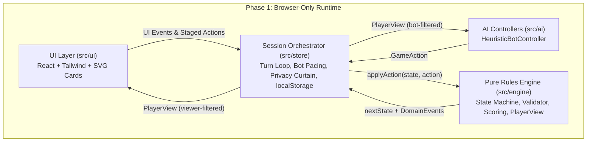
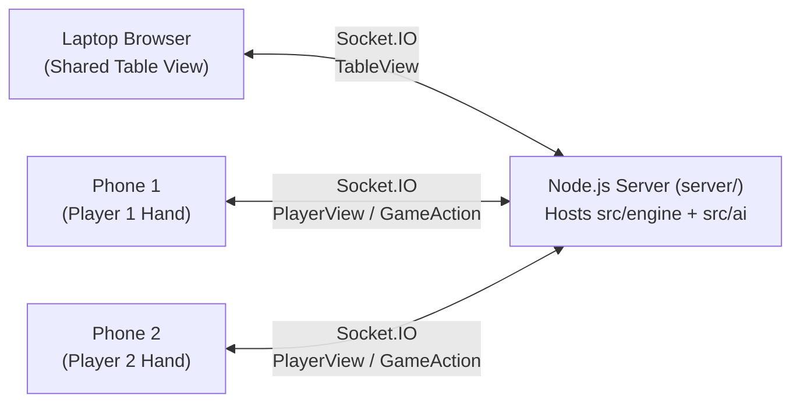
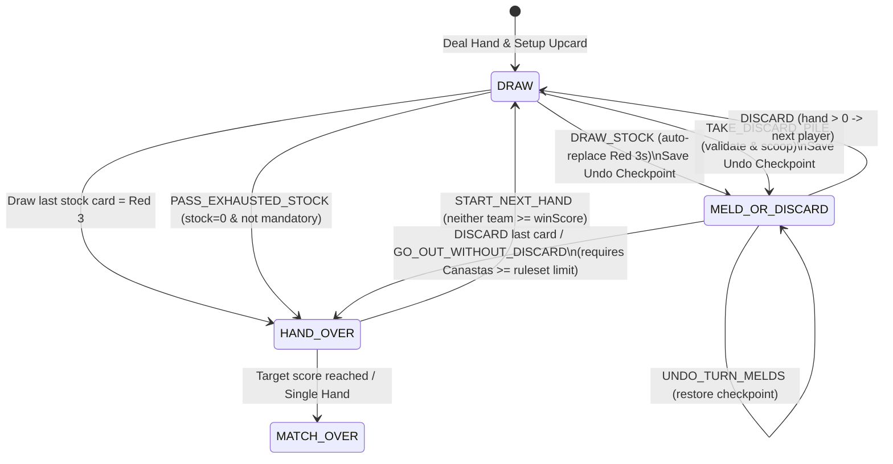

# Web-Based Canasta — Software Design Document (SDD v1.1)

> [!IMPORTANT]
> Derived from approved **PRD v1.0** and updated with all technical alignment decisions. Ready for final sign-off before initializing the Git repo and implementing Phase 1.

---

## 1. System Architecture & Evolution

The codebase enforces a strict **4-layer unidirectional architecture**. All game rules live in a pure, deterministic, headless TypeScript engine (`src/engine/`) with zero React, DOM, or browser dependencies.



### Phase 2 / 3 Seamless Expansion (Zero Engine Rewrite)
When adding **Laptop-as-Table + Phones-as-Hands (LAN)** and **Online Multiplayer**, `src/engine/` and `src/ai/` move directly behind a thin Node.js WebSocket server (`server/`). The browser UI remains unchanged because it already speaks exclusively in `GameAction` commands and `PlayerView` snapshots.



---

## 2. Repository & Directory Structure

Target workspace: `c:\Users\timot\Downloads\antigravity\canasta` (native Windows, Git repository initialized at project root, TypeScript + Vite + React + Tailwind CSS + Vitest).

> [!TIP]
> **Compile-Time Headless Isolation (`tsconfig.engine.json`):** A dedicated `tsconfig.engine.json` covers `src/engine/` and `src/ai/` with `"lib": ["ES2022"]` (excluding `DOM` and React types) and runs in `npm run typecheck`. This guarantees the rules engine and AI remain 100% pure and ready for direct import by `server/` in Phase 2 without monorepo boilerplate.

```text
canasta/
├── docs/                           # Committed copies of locked prd.md & sdd.md
├── public/
│   └── cards/                      # Vendored CC0 traditional SVG deck (52 faces + 2 jokers + ornate back)
├── src/
│   ├── engine/                     # 100% pure TypeScript — enforced by tsconfig.engine.json
│   │   ├── types.ts                # Core interfaces (Card, Meld, RulesetConfig, GameState, etc.)
│   │   ├── rulesets.ts             # BICYCLE_2P_CLASSIC, BICYCLE_4P_CLASSIC, match presets
│   │   ├── deck.ts                 # 108-card creation, seeded PRNG shuffle (mulberry32)
│   │   ├── validation.ts           # Meld legality, initial meld math, discard pickup checks
│   │   ├── scoring.ts              # Card values, Canasta/Red 3/Going Out breakdown calculator
│   │   ├── reducer.ts              # Pure applyAction(state, action) state machine, turn undo & replayHand()
│   │   ├── view.ts                 # getPlayerView(state, viewerId) hidden-info projection
│   │   └── index.ts                # Public engine barrel export
│   ├── ai/                         # Pluggable PlayerController layer (also covered by tsconfig.engine.json)
│   │   ├── controller.ts           # PlayerController interface
│   │   ├── heuristicBot.ts         # Phase 1 rule-based bot (Easy / Normal)
│   │   ├── meldSolver.ts           # Subset/knapsack helper for initial melds & optimal melding
│   │   └── index.ts
│   ├── store/                      # Client runtime orchestrator (React-friendly store)
│   │   ├── gameSession.ts          # Manages engine state, staged draft, bot pacing timer
│   │   ├── persistence.ts          # Versioned localStorage auto-save / resume & JSON replay export
│   │   └── privacyCurtain.ts       # Pass-and-play curtain trigger & safe public recap
│   ├── ui/
│   │   ├── components/
│   │   │   ├── PlayingCard.tsx     # SVG card renderer (face-up, face-down, sideways, lifted)
│   │   │   ├── CardHand.tsx        # Adaptive 1-to-2 row sorted fan with click/tap selection
│   │   │   ├── StockAndDiscard.tsx # Stock stack + discard pile with sideways freeze indicator
│   │   │   ├── MeldZone.tsx        # Team melds, squared red/black Canastas + inspect popover
│   │   │   ├── RedThreeTray.tsx    # Exposed Red 3 display with bonus/penalty badge
│   │   │   ├── ActionBar.tsx       # Contextual Meld / Guided Take-Pile / Undo / Discard bar
│   │   │   ├── ActionLog.tsx       # Compact scrollable move feed + Red 3 exposure toast
│   │   │   ├── RulesScoringDrawer.tsx # Dynamic Rules & Scoring overlay from RulesetConfig
│   │   │   ├── HandSummaryModal.tsx   # Itemized end-of-hand & end-of-match breakdown
│   │   │   ├── GuardrailModal.tsx  # Confirmation prompt for high-stakes plays
│   │   │   └── PrivacyCurtain.tsx  # Full-screen pass-and-play handover overlay
│   │   ├── screens/
│   │   │   ├── StartScreen.tsx     # Mode select (Solo vs Bot / Pass & Play), match length, Resume
│   │   │   └── TableScreen.tsx     # Green casino felt table assembling all components
│   │   └── styles/
│   │       └── felt.css            # Green felt radial texture, subtle card shadows, transitions
│   ├── App.tsx
│   └── main.tsx
├── tests/
│   ├── engine/                     # Exhaustive Bicycle Canasta rule, edge-case & replay tests
│   └── ai/                         # Heuristic AI decisions + 500-hand bot-vs-bot soak tests
├── package.json
├── tsconfig.json
├── tsconfig.engine.json            # Enforces pure ES2022-only build for src/engine & src/ai
├── vite.config.ts
└── vitest.config.ts
```

---

## 3. Core Data Models (`src/engine/types.ts`)

### 3.1 Cards & Melds

```ts
export type Suit = 'hearts' | 'diamonds' | 'clubs' | 'spades';
export type NaturalRank = '4' | '5' | '6' | '7' | '8' | '9' | '10' | 'J' | 'Q' | 'K' | 'A';
export type Rank = NaturalRank | '2' | '3' | 'JOKER';

export interface Card {
  /** Unique across both decks, e.g. "d0-KH", "d1-KH", "d0-JOKER-R", "d1-JOKER-B" */
  id: string;
  deckIndex: 0 | 1;
  rank: Rank;
  suit: Suit | 'joker';
  color: 'red' | 'black';
}

export type MeldRank = NaturalRank | '3B'; // '3B' = Black 3s (only legal when going out)

export interface Meld {
  id: string;
  rank: MeldRank;
  cards: Card[];
  naturalCount: number;
  wildCount: number;
  isCanasta: boolean; // cards.length >= 7
  canastaType: 'natural' | 'mixed' | null;
}
```

### 3.2 Parameterized Ruleset (`RulesetConfig`)

Every rule check and every row in the **Rules & Scoring Drawer** reads directly from `RulesetConfig`:

```ts
export interface InitialMeldThreshold {
  minScore: number; // Inclusive lower bound (-Infinity for negative scores)
  requiredPoints: number;
}

export interface RulesetConfig {
  id: string;
  name: string;
  description: string;
  playerCount: 2 | 4;
  teamCount: 2;
  dealSize: number;               // 15 (2P) | 11 (4P)
  drawCount: number;              // 2 (2P)  | 1 (4P)
  canastasRequiredToGoOut: number;// 2 (2P)  | 1 (4P)
  winScore: number | null;        // 5000 | 2500 | null (single hand)
  initialMeldThresholds: InitialMeldThreshold[];
  minMeldSize: number;            // 3
  minNaturalsPerMeld: number;     // 2
  maxWildsPerMeld: number;        // 3
  requireNaturalMajority: boolean;// false (Classic Bicycle); true for strict variants
  allowAllWildMelds: boolean;     // false (Classic Bicycle)
  allowBlackThreeMeldOnGoOut: boolean; // true
  goingOutBonus: number;          // 100
  concealedGoingOutExtraBonus: number; // 100 (total 200)
  naturalCanastaBonus: number;    // 500
  mixedCanastaBonus: number;      // 300
  redThreeValue: number;          // 100
  allFourRedThreesBonus: number;  // 800
  penalizeRedThreesWithoutInitialMeld: boolean; // true
}
```

### 3.3 Game State, Discard Pile & Turn Phases

```ts
export type TurnPhase =
  | 'DRAW'             // Active player must draw stock or legally take discard pile
  | 'MELD_OR_DISCARD'  // Active player may commit/undo melds, discard, or go out
  | 'HAND_OVER'        // Hand finished; showing itemized HandScoreBreakdown
  | 'MATCH_OVER';      // Target winScore reached (or single-hand match ended)

export interface DiscardPile {
  cards: Card[];
  /** True if a wild card was discarded or a wild/red-3 was turned on deal; cleared on pickup */
  frozenByWildOrInitial: boolean;
  /** Card ID of the freezing card (rendered sideways peeking out of the discard stack) */
  frozenCardId: string | null;
  /** True only while the current top card is a Black 3 (expires as soon as another card covers it) */
  blockedByBlackThree: boolean;
}

export interface TeamState {
  id: 'team-0' | 'team-1';
  name: string;
  playerIds: string[];
  melds: Meld[];
  redThrees: Card[];
  hasMadeInitialMeld: boolean;
  /** Tracks whether the active player has EVER melded/added before this turn (for Concealed Go-Out) */
  meldedByPlayerIds: string[];
  cumulativeScore: number;
  handHistory: HandScoreBreakdown[];
}

export interface PlayerState {
  id: string;
  name: string;
  teamId: 'team-0' | 'team-1';
  seatIndex: number;
  kind: 'human' | 'bot';
  botDifficulty?: 'easy' | 'normal';
  hand: Card[];
  hasTakenFirstTurn: boolean;
}

export interface GameState {
  schemaVersion: 1;
  matchId: string;
  seed: number;
  rngState: number;
  handNumber: number;
  dealerIndex: number;
  ruleset: RulesetConfig;
  players: PlayerState[];
  teams: [TeamState, TeamState];
  activePlayerIndex: number;
  phase: TurnPhase;
  stock: Card[];
  discardPile: DiscardPile;
  /** Snapshot captured right after DRAW/TAKE_DISCARD so melds made this turn can be undone safely */
  turnUndoCheckpoint: TurnUndoCheckpoint | null;
  /** Append-only committed actions for the current hand (supports deterministic replay & bug-report export) */
  handSeed: number;
  actionHistory: GameAction[];
  /** Public human-readable action log entries */
  actionLog: ActionLogEntry[];
  /** Populated in HAND_OVER / MATCH_OVER */
  lastHandSummary: HandSummary | null;
  winnerTeamId: 'team-0' | 'team-1' | null;
}
```

### 3.4 Actions (`GameAction`) & Strict View Projection (`PlayerView`)

```ts
export interface MeldDraftItem {
  kind: 'new_meld';
  rank: MeldRank;
  cardIds: string[];
}

export interface AddToMeldDraftItem {
  kind: 'add_to_meld';
  meldId: string;
  cardIds: string[];
}

export type MeldSubmission = MeldDraftItem | AddToMeldDraftItem;

export type GameAction =
  | { type: 'DRAW_STOCK'; playerId: string }
  | {
      type: 'TAKE_DISCARD_PILE';
      playerId: string;
      /** How the top discard card is immediately used */
      topCardUsage:
        | { kind: 'new_meld'; handCardIds: string[] }
        | { kind: 'add_to_meld'; meldId: string };
      /** Additional hand melds needed simultaneously to hit the initial meld minimum */
      additionalInitialMelds?: MeldDraftItem[];
    }
  | { type: 'COMMIT_MELDS'; playerId: string; submissions: MeldSubmission[] }
  | { type: 'UNDO_TURN_MELDS'; playerId: string }
  | { type: 'DISCARD'; playerId: string; cardId: string }
  | { type: 'GO_OUT_WITHOUT_DISCARD'; playerId: string }
  | { type: 'PASS_EXHAUSTED_STOCK'; playerId: string }
  | { type: 'START_NEXT_HAND' };
```

> [!IMPORTANT]
> **`getPlayerView(state, viewerPlayerId)` Security Contract:**
> - Returns **only** `viewerPlayerId`'s own `hand: Card[]`.
> - Replaces all other players' hands with `handCount: number`.
> - Replaces `stock` with `stockCount: number`.
> - Replaces `discardPile.cards` with `{ topCard, count, isFrozenForViewer, frozenCard, isBlockedByBlackThree }` (never exposing buried cards).
> - Both the React UI and the Heuristic Bot consume `PlayerView` exclusively—making AI "cheating" impossible and guaranteeing Phase 2/3 network privacy out of the box.

---

## 4. State Machine & Bicycle Rules Edge Cases



### Critical Edge Cases Enforced in `validation.ts` & `reducer.ts`
1. **Initial Upcard Setup**: After dealing, pop stock cards onto `discardPile` until a natural `4–A` appears. If any preceding upcard is a Wild Card or Red 3, set `frozenByWildOrInitial = true` and `frozenCardId` to that card.
2. **Automatic Red 3 Exposure**:
   - On a player's very first turn (at transition into `DRAW`), any Red 3s dealt in their hand are exposed to `team.redThrees` and replaced one-for-one from `stock` (looping if a replacement is also a Red 3), emitting clear `ActionLogEntry` items so the player sees what happened.
   - During `DRAW_STOCK`, any drawn Red 3 is immediately exposed and replaced from stock.
   - If the **very last card of the stock** is a Red 3, expose it and transition immediately to `HAND_OVER` (no meld, no discard, no going-out bonus).
   - During `TAKE_DISCARD_PILE`, any Red 3s inside the scooped pile are exposed immediately with **no** replacement from stock.
3. **2-Player Draw-2 with 1 Stock Card Left**: If `stock.length === 1` in 2-player mode (`drawCount === 2`), `DRAW_STOCK` draws the remaining 1 card cleanly and applies standard stock-exhaustion rules.
4. **Initial Meld & Concealed Going Out**:
   - Normally, a team's first `COMMIT_MELDS` or `TAKE_DISCARD_PILE` must sum base card point values (`getCardPoints`) ≥ the team's threshold based on `cumulativeScore` at the **start of the hand**.
   - **Bicycle Concealed Exception**: If the player melds their entire hand in one turn (leaving 0 or 1 card to discard) *including* the required Canasta(s) and has never melded/added earlier in the hand:
     - If they drew from stock, the initial meld minimum is **waived** and they earn `+200` (`goingOutBonus + concealedGoingOutExtraBonus`).
     - If they took the discard pile on that turn, they **must still satisfy** the initial meld minimum using hand cards + top discard card before scooping.
5. **Preventing Illegal 0-Card Traps**:
   - A `COMMIT_MELDS` or `DISCARD` action that leaves `hand.length === 0` is **rejected** unless the team's post-action Canasta count meets `ruleset.canastasRequiredToGoOut`.
   - `COMMIT_MELDS` with Black 3s (`rank: '3B'`) is **only valid** if the submission results in the player going out immediately (0 cards left, or 1 card left to discard while meeting Canasta requirement) and contains 3 or 4 natural Black 3s with zero wilds.
6. **Mandatory Take on Exhausted Stock**:
   - When `stock.length === 0` during `DRAW`, if the discard pile is unfrozen for the player, not blocked by a Black 3/Wild/Red 3, and the top card matches an existing meld on the player's team (and adding it doesn't illegally empty the hand without meeting Canasta count), `PASS_EXHAUSTED_STOCK` is disabled and taking the discard pile is **mandatory**.
7. **Safe Turn Undo (`UNDO_TURN_MELDS`)**:
   - Restores `teams`, `players[active].hand`, and appends an undo note without touching `stock`, `discardPile`, or cards drawn/scooped during `DRAW`. Therefore players can freely experiment with melds and undo before discarding, with zero information-leak exploits.

### Automatic Scoring Breakdown (`HandScoreBreakdown`)
Calculated automatically on entry to `HAND_OVER`:
- `meldedCardPoints`: sum of base card values across all `team.melds`
- `naturalCanastaPoints`: `naturalCount * 500`
- `mixedCanastaPoints`: `mixedCount * 300`
- `redThreePoints`:
  - `0` if `redThrees.length === 0`
  - `+800` if `redThrees.length === 4` (or `-800` if `!team.hasMadeInitialMeld`)
  - `±100 * redThrees.length` otherwise (positive if `hasMadeInitialMeld`, negative if not)
- `goingOutBonus`: `100` (or `200` if concealed) for the winning side, `0` if stock exhausted
- `unmeldedHandPenalty`: negative sum of base card values left in hand(s) of all players on that team
- `handNetScore`: sum of all components above.

---

## 5. Heuristic AI Design (`src/ai/`)

### 5.1 Pluggable Controller Contract (`src/ai/controller.ts`)

```ts
export interface PlayerController {
  readonly id: string;
  /** Receives ONLY PlayerView — never full GameState */
  chooseAction(view: PlayerView): Promise<GameAction> | GameAction;
}
```

This same contract will later support `RemoteSocketController` (Phase 2/3) and `LLMAgentController` (Phase 3).

### 5.2 Phase 1 `HeuristicBotController` Decision Pipeline
Executes in `< 5 ms` per action, decomposed into three clean phases:

1. **Draw Phase (`chooseDrawAction`)**:
   - Checks if `TAKE_DISCARD_PILE` is legal (respecting frozen/unfrozen rules & initial meld threshold via `meldSolver.findBestInitialMeldWithTopCard`).
   - Scores pickup utility:
     - `+25` per card in discard pile + face value of top card.
     - `+250` if it completes a Canasta (especially Natural `+400`).
     - `+120` if it unlocks the team's initial meld.
     - Penalty (`-180`) if pile size is tiny (`≤ 2`) and opponent has `≤ 4` cards with Canastas ready (avoids taking dead weight right before opponent goes out).
   - Takes discard pile if utility > threshold (`> 40` on Normal, `> 80` on Easy); otherwise `DRAW_STOCK` (or mandatory take / `PASS_EXHAUSTED_STOCK` when stock is empty).

2. **Meld Phase (`chooseMeldAction`)**:
   - **Before Initial Meld**: Runs `meldSolver.findOptimalInitialMelds(hand, requiredPoints)` (exact branch-and-bound over the 11 distinct natural ranks—tiny search space, instant runtime!) to hit the 50/90/120 threshold while **minimizing wild cards spent** and **preserving Natural Canasta candidates** (ranks with 4+ naturals).
   - **After Initial Meld**:
     - Always checks if **going out** is legal and profitable (completes ≥ 2 Canastas in 2P, or dumps Black 3s to go out cleanly).
     - Melds natural sets (3+ naturals) and adds matching naturals to existing melds immediately.
     - **Wild Card Discipline (Normal difficulty)**:
       - Never adds a wild card to an existing **Natural Canasta** unless doing so allows going out immediately.
       - Prefers holding wild cards until they either complete a Mixed Canasta (7 cards) or protect a strong 4–5 natural meld.
   - Returns `COMMIT_MELDS` if worthwhile melds exist; otherwise proceeds to Discard.

3. **Discard Phase (`chooseDiscardAction`)**:
   - Scores every legal discard candidate (lowest "keep value" = best discard):
     - **Avoid feeding opponent**: Heavy penalty (`+80`) if rank matches an **opponent's existing meld** and discard pile is unfrozen.
     - **Protect own structure**: High keep value for Wild Cards (`+120`), ranks matching own melds (`+70`), natural pairs (`+55`), and high-point cards (Aces `+30`, 8–K `+15`).
     - **Tactical Black 3**: If discard pile is large (`≥ 6` cards) and unfrozen, strongly favors discarding a Black 3 to block opponent for a turn!
     - **Emergency Freeze**: On Normal difficulty, considers freezing with a 2 only if pile is huge (`≥ 10` cards), unfrozen, and opponent is likely to scoop it next turn.
     - **Easy Difficulty**: Uses simpler greedy weights + small seeded jitter so casual players have an approachable warm-up opponent.

---

## 6. Card Rendering & UI Component Architecture

### 6.1 SVG Playing Card Asset Strategy
- **Asset Source**: Vendored **CC0 / Public Domain traditional SVG playing cards** (illustrated court cards, distinct Red & Black Jokers, ornate card back) stored directly in `public/cards/` using clean deterministic filenames (`2C.svg` .. `AS.svg`, `JOKER-R.svg`, `JOKER-B.svg`, `BACK.svg`).
- **Offline & Zero-CDN Guarantee**: Every card loads locally from Vite's static assets—works 100% offline with crisp vector scaling on 1080p laptops, 4K monitors, and mobile phones.
- **`<PlayingCard />` Component**:
  - Fixed `5:7` aspect ratio, crisp white card border, subtle drop shadow against green casino felt.
  - Props: `card?: Card`, `faceDown?: boolean`, `selected?: boolean` (raises card `14px` with gold outline), `rotated?: boolean` (90° sideways for the frozen discard card), `size?: 'sm' | 'md' | 'lg'`, `dimmed?: boolean` (unusable cards during certain prompts), `onClick`.

### 6.2 Green Casino Felt Table Layout (`TableScreen.tsx`)
Structured as a full-viewport (`100dvh`, zero page scroll) 3-band casino table:

| Region | Contents |
| :--- | :--- |
| **Top Bar** | Match title & active ruleset pill (`Bicycle 2P Classic`), compact live score badges (`You: 1,240` vs `CPU: 890`), bot speed toggle, **Rules & Scoring** drawer button, Export Replay JSON option (in menu), New/Menu button. |
| **Upper Band (Opponent)** | Opponent name, card-back fan with hand count badge, Opponent Red 3 tray, Opponent Meld & Canasta piles (squared stacks with Red/Black top badge + click-to-inspect). |
| **Center Felt Band** | Left: **Stock Pile** (clickable to draw + count badge) & **Discard Pile** (top card, pile count, sideways peeking wild card + Frozen/Blocked badge, click to start guided pickup). Right: Compact **Action Log** feed (collapsible on narrow screens) + transient Red 3 exposure toast banner. |
| **Lower Band (Active Player)** | Player Red 3 tray & Meld/Canasta piles → **Contextual Action Bar** (shows staged melds or Guided Take-Pile preview, live initial meld counter e.g. `55 / 50 pts ✓`, `Stage Meld`, `Commit Melds`, `Undo Turn Melds`, `Discard`, `Go Out`) → **Adaptive Card Hand** (auto-sorted by rank, wraps smoothly into 2 rows when `> 18` cards). |

### 6.3 Key UX Flows
- **Guided "Take Discard Pile" Staging Mode**:
  - Clicking the discard pile during `DRAW` enters a focused staging preview with the top discard card locked into a preview slot (no buried cards are revealed yet, and the player can click `Cancel` freely).
  - If the pile is **unfrozen** and the top card matches an existing team meld (and initial meld is already met), the action bar offers a 1-click `Add Top Card & Take Pile` shortcut alongside forming a new meld.
  - If forming a new meld (or when **frozen**), the player clicks matching cards in hand (with invalid cards dimmed; e.g., wilds dimmed when frozen) and may also stage additional melds from hand if needed to hit the `50 / 90 / 120` initial meld minimum—showing live point math (`55 / 50 pts ✓`) before clicking `Confirm Take Pile`.
- **Automatic Red 3 Exposure & Callouts**:
  - Starting-hand Red 3s (on a player's first turn) and stock-drawn Red 3s are exposed and replaced automatically by the engine; the UI displays a crisp toast banner (*"Exposed 3♥ → drew replacement"*) and logs the event so the player always sees why a card moved.
- **Staged Multi-Meld Flow**: Clicking cards in hand toggles selection. Clicking `Stage Meld` moves those cards into a visual staging strip (allowing a second/third meld to be staged simultaneously to meet a 50/90/120 initial meld). Clicking `Commit Melds` dispatches a single atomic `COMMIT_MELDS` action.
- **High-Stakes Guardrail Modal**: Triggered in UI before dispatching when:
  - Adding a wild card to a completed **Natural Canasta** (warns: *"Downgrades +500 Natural Canasta to +300 Mixed Canasta"*).
  - Discarding a **Wild Card** (warns: *"Freezes the discard pile and spends a 20/50 pt wild card"*).
  - Discarding a **Black 3** when the discard pile is empty or already frozen.
- **Pass-and-Play Privacy Curtain (`PrivacyCurtain.tsx`)**:
  - Active only when both seats are `'human'`.
  - Immediately mounts upon `DISCARD` (before the next player's hand renders!), showing a clean green-felt curtain with *"Pass laptop to [Player Name]"*, a safe public summary of the last turn's moves, and a *"Reveal Hand (Space / Click)"* button.
  - Pressing `H` at any time toggles the privacy curtain manually.
- **Dynamic Rules & Scoring Drawer (`RulesScoringDrawer.tsx`)**:
  - Reads live `view.ruleset`, `view.teams`, and `view.initialMeldRequired` to render exact active rules (highlighting the player's current initial meld tier) and an itemized hand-by-hand scoreboard.

### 6.4 Persistence (`src/store/persistence.ts`)
- Saves serialized `GameState` + UI preferences (bot speed) to `localStorage` under key `canasta_saved_match_v1` after every committed engine transition.
- Validates `schemaVersion === 1` on load; corrupt or outdated payloads fail safely back to the Start Screen without crashing.

---

## 7. Phase 2 Readiness: LAN Companion & WebSocket Protocol

Because `src/engine` is headless and strictly typed, Phase 2 (`server/`) only needs a thin transport adapter:
- **Client → Server**: `socket.emit('action', GameAction)` (server verifies `socket.playerId === action.playerId` before invoking `applyAction`).
- **Server → Phone Client**: `socket.emit('player_view', getPlayerView(state, playerId))`.
- **Server → Laptop Table Client**: `socket.emit('table_view', getTableView(state))` (omits *all* player hands, displays shared table, melds, discard, scoreboard, and join QR code).

---

## 8. Verification & Testing Strategy

### 8.1 Engine Unit Test Suite (`tests/engine/` — Vitest)
Every Bicycle Canasta rule gets dedicated deterministic tests:
- **Setup & Deck**: 108 unique cards, exact 15-card 2P deal, initial upcard looping over Wild/Black 3/Red 3 and properly setting `frozenByWildOrInitial` + `frozenCardId`.
- **Red 3s**: Starting-hand exposure & replacement (including chained Red 3 replacements), stock-draw replacement, no replacement when scooped from discard pile, last-stock-card Red 3 immediate hand end, `+100`/`+800` bonus vs `-100`/`-800` penalty without initial meld.
- **Melds & Wilds**: Valid 2-natural + 3-wild classic meld, rejecting >3 wilds or <2 naturals, Natural (+500) vs Mixed (+300) Canasta detection, downgrading Natural to Mixed when adding a wild.
- **Initial Melds**: All 4 score tiers (`<0`, `0–1495`, `1500–2995`, `3000+`), multi-meld batch summing, rejecting Canasta/Red 3 bonuses toward initial meld, top-discard-card-only rule when picking up pile for initial meld.
- **Discard Pile**: Frozen pile requires natural pair (rejects wild pair & existing-meld add), unfrozen allows all 3 methods, Black 3 blocks exactly 1 turn then clears, top wild/3 never claimable.
- **Going Out & Stock Exhaustion**: Blocking going out with `< 2` Canastas in 2P, Black 3 melds allowed *only* when going out, Concealed Going Out (`+200`) with stock draw vs discard pickup initial-meld rule, mandatory take when stock is empty, graceful `PASS_EXHAUSTED_STOCK`.
- **Turn Undo, Replay & Privacy**: `UNDO_TURN_MELDS` restores pre-meld hand without reverting drawn/scooped cards; `replayHand(handSeed, ruleset, actionHistory)` reproduces bit-for-bit identical `GameState`; `getPlayerView` never leaks opponent cards, stock order, or buried discard cards.
- **Compile-Time Boundary Check**: `tsc -p tsconfig.engine.json --noEmit` verifies zero DOM/React leakage in `src/engine/` and `src/ai/`.
- **Scoring**: Full end-to-end hand & multi-hand match reaching 5,000 pts.

### 8.2 AI Soak & Fuzz Test (`tests/ai/`)
- Run **500 complete seeded Bot-vs-Bot hands** in Vitest asserting:
  - Zero illegal action rejections or unhandled exceptions.
  - Every hand terminates cleanly (no infinite loops).
  - Conservation of cards (`108` cards accounted for across stock + discard + hands + melds + red 3s on every single turn!).

### 8.3 Browser Verification
- Start the local Vite dev server and inspect the live green-felt table in the browser: verify SVG card rendering, fanned & 2-row large-hand layouts, staged initial meld workflow, frozen discard sideways card, Rules & Scoring drawer, Pass-and-Play privacy curtain, and reload persistence.

---

## 9. Phase 1 Implementation Milestones

| Step | Milestone | Deliverables (with clean Git commit per milestone) |
| :--- | :--- | :--- |
| **1** | **Repo Init, Docs, Scaffold & Card Assets** | Initialize Git in `c:\Users\timot\Downloads\antigravity\canasta`, commit `docs/prd.md` & `docs/sdd.md`, scaffold Vite + React + TypeScript (`tsconfig.engine.json`) + Tailwind + Vitest, vendor CC0 traditional SVG playing cards in `public/cards/`. |
| **2** | **Pure Rules Engine + Full Test Suite** | Implement `src/engine/*` (`types`, `rulesets`, `deck`, `validation`, `scoring`, `reducer` + `replayHand`, `view`) and achieve 100% passing Vitest coverage across all Bicycle edge cases + engine typecheck. |
| **3** | **Heuristic Bot + 500-Hand Soak Test** | Implement `src/ai/*` (`PlayerController`, `meldSolver`, `heuristicBot`) and pass deterministic + 500-hand card-conservation soak tests. |
| **4** | **Session Orchestrator & Persistence** | Implement `src/store/*` (bot turn pacing, Pass-and-Play privacy curtain state, `localStorage` auto-save/resume, replay JSON export). |
| **5** | **Green-Felt Casino UI & Verification** | Build `src/ui/*` (Start Screen, Table Screen, PlayingCard, Adaptive Hand, Guided Take-Discard-Pile & Multi-Meld Staging Bar, Guardrails, Dynamic Rules & Scoring Drawer, Hand Summary Modal, Privacy Curtain) and verify end-to-end in the browser. |
